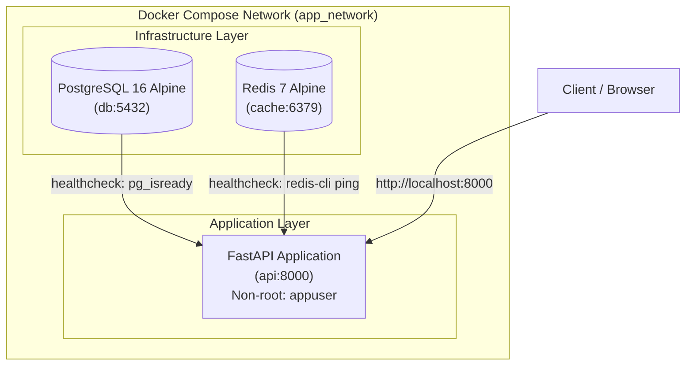

# FastAPI + PostgreSQL + Redis Docker Base Environment

[](https://fastapi.tiangolo.com)
[](https://www.python.org/)
[](https://www.postgresql.org/)
[](https://redis.io/)
[](https://www.docker.com/)

Продакшн-орієнтований шаблон контейнеризованого середовища для швидкого старту та розробки асинхронних бекенд-сервісів на базі **FastAPI**, реляційної СУБД **PostgreSQL 16** та високоефективного кешу **Redis 7**. 

Шаблон реалізує безпечну збірку Docker-образу з non-root користувачем, оркестрацію через Docker Compose із контролем стану сервісів (**Healthcheck Dependency Tree**) та перевірку з'єднань із базами даних.

---

## 🛠 Технологічний стек

* **Мова та фреймворк:** Python 3.11-slim, FastAPI
* **ASGI Сервер:** Uvicorn (standard)
* **База даних:** PostgreSQL 16 (Alpine Linux)
* **Кешування та черги:** Redis 7 (Alpine Linux)
* **Драйвери підключення:** `psycopg2-binary`, `redis-py`
* **Контейнеризація:** Docker Engine, Docker Compose

---

## 🏛 Архітектура сервісів

Оркестрація налаштована таким чином, що основний API-сервіс запускається лише після того, як залежні інфраструктурні сервіси (`db` та `cache`) успішно пройдуть власні перевірки готовності (**Service Healthy**):



---

## 📁 Структура проєкту

```text
docker-base/
├── app/
│   ├── __init__.py
│   └── main.py              # Точка входу FastAPI з маршрутами / та /health
├── .dockerignore            # Виключення зайвих файлів із контексту збірки
├── .env.example             # Зразок конфігурації змінних оточення
├── .gitignore               # Виключення тимчасових файлів для Git
├── Dockerfile               # Багатошаровий безпечний Dockerfile (Non-root user)
├── docker-compose.yml       # Маніфест оркестрації сервісів (api, db, cache)
├── requirements.txt         # Базові залежності (FastAPI, uvicorn, psycopg2, redis)
└── README.md                # Документація проєкту
```

---

## 🔒 Особливості Docker-конфігурації

1. **Безпека контейнера:**
   * Усередині контейнера створюється виділена системна група та користувач без прав root: `appuser:appgroup` (`UID/GID`).
   * Застосунок виконується виключно від імені `appuser`, що унеможливлює ескалацію привілеїв у разі вразливостей.
2. **Оптимізація образу:**
   * Прапорці `PYTHONDONTWRITEBYTECODE=1` та `PYTHONUNBUFFERED=1` вимикають створення сміттєвих `.pyc` файлів та забезпечують миттєвий вивід логів у консоль.
   * Очищення кешу пакетизатора `--no-cache-dir` знижує кінцевий розмір образу до мінімуму.
3. **Надійні Healthchecks:**
   * **PostgreSQL:** перевірка через `pg_isready -U ${POSTGRES_USER} -d ${POSTGRES_DB}`.
   * **Redis:** перевірка через `redis-cli ping`.
   * **API:** чекає стану `service_healthy` обох контейнерів перед запуском.

---

## 🚀 Швидкий запуск

### 1. Клонування репозиторію
```bash
git clone https://github.com/kirkiiruch/docker-fastapi-postgres-redis-template.git
cd docker-fastapi-postgres-redis-template
```

### 2. Налаштування змінних середовища
Створіть файл `.env` на основі наданого зразка `.env.example`:
```bash
cp .env.example .env
```

Вміст `.env`:
```env
# Порт додатку на хості
APP_PORT=8000

# Параметри доступу до PostgreSQL
POSTGRES_USER=app_user
POSTGRES_PASSWORD=supersecretpassword
POSTGRES_DB=app_db
POSTGRES_PORT=5432

# Порт Redis на хості
REDIS_PORT=6379
```

### 3. Збірка та запуск контейнерів
Запустіть стек у фоновому режимі (detached mode) з автоматичною збіркою:
```bash
docker compose up -d --build
```

### 4. Моніторинг статусу
Перевірте, чи всі сервіси перебувають у статусі `healthy` / `running`:
```bash
docker compose ps
```

---

## 📡 Базові ендпоінти API

Після запуску застосунок доступний за адресою: `http://localhost:8000`.

### 1. Перевірка статусу сервісу (`/`)
* **Метод:** `GET`
* **URL:** `http://localhost:8000/`
* **Відповідь (200 OK):**
```json
{
  "status": "running",
  "environment": "docker"
}
```

### 2. Системний Healthcheck із перевіркою підключень (`/health`)
* **Метод:** `GET`
* **URL:** `http://localhost:8000/health`
* **Опис:** Виконує реальне тестове підключення до PostgreSQL та відправляє `PING` у Redis.
* **Відповідь (200 OK):**
```json
{
  "database": "connected",
  "cache": "connected"
}
```

---

## 📚 Інтерактивна документація OpenAPI

FastAPI автоматично генерує інтерактивну документацію з можливістю тестування запитів:

* **Swagger UI:** [http://localhost:8000/docs](http://localhost:8000/docs)
* **ReDoc:** [http://localhost:8000/redoc](http://localhost:8000/redoc)

---

## 🛠 Керування життєвим циклом (Корисні команди)

* **Перегляд логів у реальному часі:**
  ```bash
  docker compose logs -f api
  ```
* **Перегляд логів конкретного сервісу:**
  ```bash
  docker compose logs -f db
  docker compose logs -f cache
  ```
* **Зупинка сервісів із збереженням томів даних:**
  ```bash
  docker compose down
  ```
* **Повна зупинка з видаленням збережених даних (томи PostgreSQL та Redis):**
  ```bash
  docker compose down -v
  ```
* **Вхід у термінал працюючого контейнера API:**
  ```bash
  docker compose exec api bash
  ```

---

## 🧩 Використання як основи для нових проєктів

1. Використовуйте цей репозиторій як шаблон для старту нового мікросервісу.
2. Додавайте моделі ORM (наприклад, SQLAlchemy чи Tortoise-ORM) у директорію `app/models/`.
3. Додавайте схеми валідації Pydantic у директорію `app/schemas/`.
4. Підключайте бізнес-роутери через `app.include_router(...)` у `app/main.py`.
