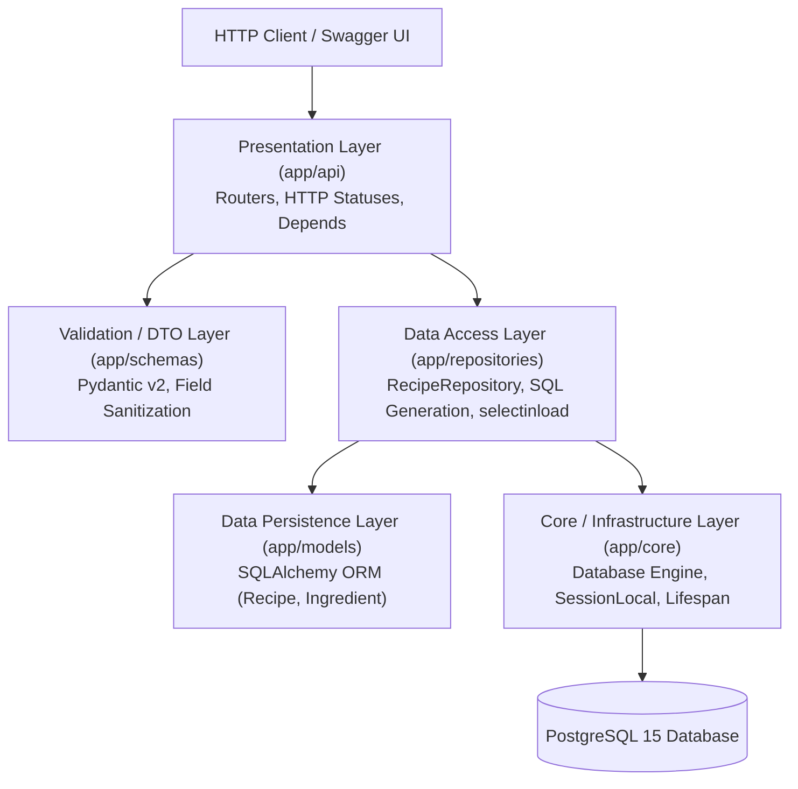
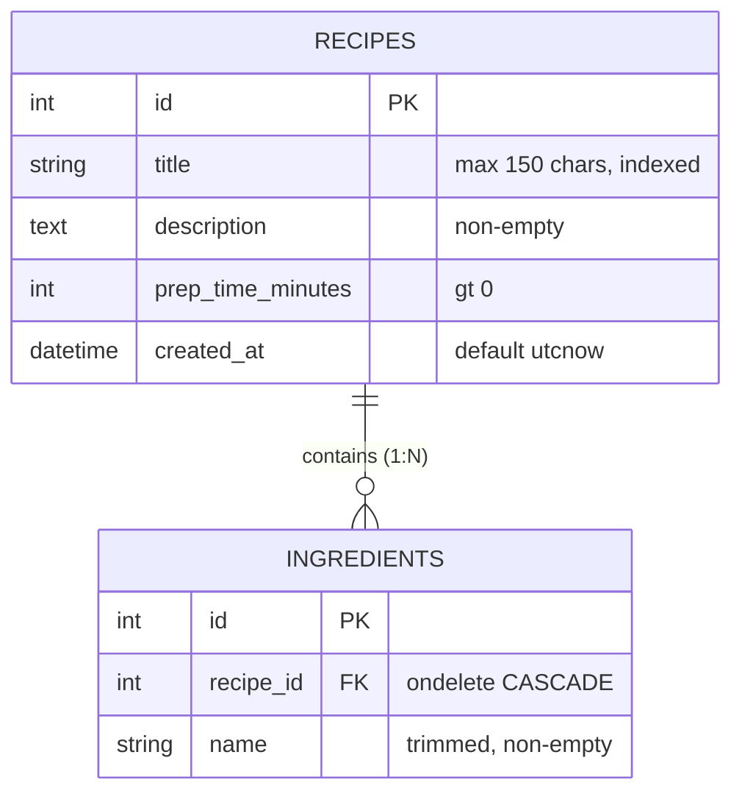

# Recipe Management REST API

[](https://fastapi.tiangolo.com)
[](https://www.python.org/)
[](https://www.postgresql.org/)
[](https://www.sqlalchemy.org/)
[](https://docs.pydantic.dev/)
[](https://www.docker.com/)

Сучасний асинхронний REST API для централізованого управління каталогом кулінарних рецептів та інгредієнтів. Сервіс спроєктовано з дотриманням принципів **багатошарової архітектури (Onion / Clean Architecture)**, суворої типізації даних Pydantic v2, повної контейнеризації робочого середовища та захисту цілісності даних на рівні СУБД.

---

## 🛠 Технологічний стек

* **Веб-фреймворк:** FastAPI (Python 3.11+)
* **ORM & СУБД:** SQLAlchemy 2.0 (Declarative Base, 2.0 style queries), PostgreSQL 15 (Alpine), драйвер `psycopg2-binary`
* **Валідація та DTO:** Pydantic v2 (`field_validator`, `ConfigDict(extra="forbid")`)
* **Оркестрація та контейнеризація:** Docker Engine, Docker Compose
* **ASGI Сервер:** Uvicorn із підтримкою сучасного контекстного менеджера життєвого циклу (`lifespan`)

---

## 🏛 Архітектурний дизайн (Onion Architecture)

Сервіс розділено на слабозв'язані шари із чітким розмежуванням відповідальності (Separation of Concerns):



### Структура проєкту
```text
docker-base/
├── app/
│   ├── api/                  # Presentation Layer (HTTP-контролери та DI)
│   │   ├── dependencies.py   # Фабрики впровадження залежностей сесії БД (Depends)
│   │   └── recipes.py        # Роутери, обробка статусів, помилок та параметрів
│   ├── core/                 # Core Layer (Конфігурація інфраструктури)
│   │   └── database.py       # Engine, Base, фабрика сесій sessionmaker
│   ├── models/               # Persistence Layer (ORM-моделі SQLAlchemy)
│   │   └── recipe.py         # Моделі Recipe та Ingredient, каскади
│   ├── repositories/         # Data Access Layer (Паттерн Репозиторій)
│   │   └── recipe_repo.py    # CRUD, випереджальне завантаження, фільтрація
│   ├── schemas/              # Business Validation Layer (Pydantic DTOs)
│   │   └── recipe.py         # RecipeCreate, RecipeUpdate, RecipeResponse
│   └── main.py               # Точка входу FastAPI, керування lifespan
├── docker-compose.yml        # Оркестрація сервісів (API, Postgres, Redis)
├── Dockerfile                # Складання образу API з non-root користувачем
├── requirements.txt          # Зафіксовані залежності проєкту
├── .env.example              # Шаблон змінних оточення
└── README.md                 # Документація сервісу
```

---

## 🗄 Модель даних (Entity Relationship)



---

## 📡 Специфікація API (Endpoints)

| Метод | Маршрут | Код відповіді | Опис |
| :--- | :--- | :--- | :--- |
| **POST** | `/api/recipes` | `201 Created` / `422` | Створення нового рецепта та вкладеного списку інгредієнтів |
| **GET** | `/api/recipes` | `200 OK` | Отримання каталогу рецептів із підтримкою фільтрації |
| **GET** | `/api/v1/recipes/{recipe_id}` | `200 OK` / `404` | Отримання повної інформації про конкретний рецепт |
| **PATCH** | `/api/v1/recipes/{recipe_id}` | `200 OK` / `404` / `422` | Часткове оновлення полів рецепта або списку інгредієнтів |
| **DELETE**| `/api/v1/recipes/{recipe_id}` | `204 No Content` / `404` | Видалення рецепта з каскадним очищенням інгредієнтів |
| **GET** | `/` | `200 OK` | Системний health check та перевірка працездатності |

---

## 💡 Приклади запитів (cURL & JSON)

### 1. Створення рецепта (POST `/api/recipes`)
```bash
curl -X POST "http://localhost:8000/api/recipes" \
  -H "Content-Type: application/json" \
  -d '{
    "title": "Класичний омлет із сиром",
    "description": "Швидкий та поживний сніданок за 10 хвилин",
    "prep_time_minutes": 10,
    "ingredients": ["Курячі яйця", "Молоко 2.5%", "Твердий сир", "Вершкове масло", "Сіль"]
  }'
```
*Успішна відповідь (`201 Created`):*
```json
{
  "id": 1,
  "title": "Класичний омлет із сиром",
  "description": "Швидкий та поживний сніданок за 10 хвилин",
  "prep_time_minutes": 10,
  "ingredients": ["Курячі яйця", "Молоко 2.5%", "Твердий сир", "Вершкове масло", "Сіль"]
}
```

### 2. Отримання рецептів із фільтрами (GET `/api/recipes`)
* Фільтр за максимальним часом приготування (наприклад, до 15 хвилин):
  ```bash
  curl "http://localhost:8000/api/recipes?max_prep_time=15"
  ```
* Фільтр за назвою інгредієнта (регістронезалежний пошук входження):
  ```bash
  curl "http://localhost:8000/api/recipes?ingredient=сир"
  ```
* Комбінований фільтр:
  ```bash
  curl "http://localhost:8000/api/recipes?max_prep_time=30&ingredient=яйця"
  ```

### 3. Часткове оновлення (PATCH `/api/v1/recipes/1`)
```bash
curl -X PATCH "http://localhost:8000/api/v1/recipes/1" \
  -H "Content-Type: application/json" \
  -d '{
    "prep_time_minutes": 12,
    "ingredients": ["Курячі яйця", "Молоко", "Пармезан"]
  }'
```

### 4. Видалення рецепта (DELETE `/api/v1/recipes/1`)
```bash
curl -X DELETE "http://localhost:8000/api/v1/recipes/1" -v
# Повертає HTTP 204 No Content
```

---

## 🔒 Інженерні рішення та надійність

1. **Гарантія цілісності даних (Cascade Delete):**
   * Зв'язок One-to-Many між рецептом та інгредієнтами захищено на двох рівнях:
     * На рівні бази даних: зовнішній ключ з декларацією `ondelete="CASCADE"`.
     * На рівні ORM SQLAlchemy: відношення з `cascade="all, delete-orphan"`.
   * При видаленні рецепта пов'язані записи в таблиці `ingredients` видаляються автоматично без залишку «осиротілих» рядків.
2. **Оптимізація вибірки (Запобігання проблемі N+1):**
   * Для завантаження інгредієнтів використовується стратегія `selectinload(Recipe.ingredients)`. Це виключає окремий SQL-запит на кожен знайдений рецепт і оптимізує навантаження на базу даних до одного пакетного запиту.
3. **Регістронезалежний пошук:**
   * Пошук страв за інгредієнтом реалізовано через `Recipe.ingredients.any(Ingredient.name.ilike(f"%{clean}%"))`, що дозволяє коректно знаходити інгредієнти незалежно від регістру символів чи локалі.
4. **Сувора валідація та санітизація (Pydantic v2):**
   * Автоматичне очищення рядків від зайвих пробілів (`.strip()`).
   * Заборона передачі порожніх списків інгредієнтів.
   * Конфігурація `ConfigDict(extra="forbid")` для оновлень захищає від помилкових або небажаних полів у запиті.

---

## 🚀 Швидкий запуск

### 1. Клонування репозиторію
```bash
git clone https://github.com/kirkiiruch/recipe-management-api.git
cd recipe-management-api
```

### 2. Конфігурація оточення
Створіть `.env` файл на основі `.env.example`:
```bash
cp .env.example .env
```

Зразок налаштувань:
```env
APP_PORT=8000
POSTGRES_USER=app_user
POSTGRES_PASSWORD=supersecretpassword
POSTGRES_DB=app_db
POSTGRES_PORT=5432
POSTGRES_HOST=db
REDIS_PORT=6379
```

### 3. Запуск у Docker Compose
```bash
# Збірка та старт контейнерів у фоновому режимі
docker compose up -d --build

# Перегляд логів роботи API
docker compose logs -f api
```

Сервіс автоматично створить необхідні таблиці у PostgreSQL при першому старті завдяки обробнику `lifespan`.

---

## 📖 Документація API

* **Swagger UI:** [http://localhost:8000/docs](http://localhost:8000/docs)
* **ReDoc:** [http://localhost:8000/redoc](http://localhost:8000/redoc)

---

## 🛑 Зупинка сервісів

* Зупинити контейнери зі збереженням бази даних:
  ```bash
  docker compose down
  ```
* Зупинити та повністю очистити том із даними PostgreSQL:
  ```bash
  docker compose down -v
  ```
