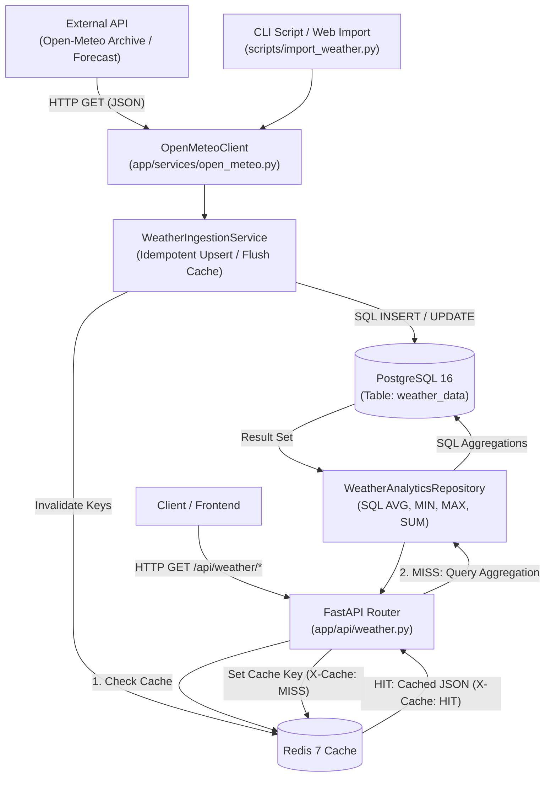

# Weather Analytics Aggregator API (Агрегатор метеорологічних даних)

[](https://fastapi.tiangolo.com)
[](https://www.python.org/)
[](https://www.postgresql.org/)
[](https://redis.io/)
[](https://www.sqlalchemy.org/)
[](https://www.docker.com/)

Високопродуктивний асинхронний бекенд-сервіс для збору, обробки, агрегації та аналізу історичних метеорологічних даних на базі відкритого API **Open-Meteo**. Сервіс реалізує збереження погодних часових рядів у **PostgreSQL 16**, виконання обчислень виключно на рівні ядра бази даних, дворівневе кешування аналітичних зрізів у **Redis 7** із контролем заголовків `X-Cache`, а також автоматизовану перевірку архітектурних критеріїв якості (**Quality Gates**).

---

## 🛠 Технологічний стек

* **Фреймворк:** FastAPI (Python 3.11+)
* **СУБД та драйвер:** PostgreSQL 16 (Alpine), `psycopg2-binary`
* **ORM:** SQLAlchemy 2.0 (Core Expressions, ORM Declarative)
* **Сховище кешу:** Redis 7 (Alpine Linux), `redis-py`
* **HTTP Клієнт:** HTTPX (асинхронний та синхронний пулінг з'єднань)
* **Валідація та DTO:** Pydantic v2
* **Контейнеризація:** Docker, Docker Compose

---

## 🏛 Архітектура потоків даних (Data Flow)



---

## 💎 Архітектурні принципи та Quality Gates

Сервіс спроєктовано з урахуванням 5 обов'язкових інженерних критеріїв якості (**Quality Gates**), що перевіряються автоматизованими тестами:

1. **Quality Gate 1: Агрегація виключно на рівні СУБД:**
   * Усі обчислення (`AVG(temperature)`, `SUM(precipitation)`, `MIN/MAX(temperature)`, групування та витяг дат через `EXTRACT`) виконуються ядром PostgreSQL за допомогою функцій SQLAlchemy (`func.avg()`, `func.sum()`, `func.max()`, `func.min()`).
   * Масив «сирих» записів ніколи не завантажується в оперативну пам'ять додатку для ручного підрахунку циклом.
2. **Quality Gate 2: Патерн Репозиторій (Repository Pattern):**
   * Усі SQL-вирази, фільтри та аналітичні запити суворо інкапсульовані в класі `WeatherAnalyticsRepository` (`app/repositories/weather.py`). Контролери FastAPI взаємодіють лише з абстракцією репозиторію.
3. **Quality Gate 3: Принцип єдиної відповідальності (SRP):**
   * Мережевий клієнт `OpenMeteoClient` (`app/services/open_meteo.py`) відповідає виключно за HTTP-взаємодію зі стороннім API та серіалізацію DTO. Він повністю ізольований від сесій бази даних.
   * Збереженням, трансформацією та інвалідацією кешу управляє окремий оркестратор `WeatherIngestionService`.
4. **Quality Gate 4: Контейнеризація середовища:**
   * Повне розгортання оточення (API, PostgreSQL, Redis) за допомогою єдиної команди `docker compose up -d`. Таблиці БД створюються автоматично при першому старті завдяки обробнику `lifespan`.
5. **Quality Gate 5: Розумне кешування в Redis:**
   * Важкі аналітичні запити кешуються в Redis за детермінованими ключами (`weather:average:...`, `weather:extremes:...`, `weather:monthly:...`).
   * Перший запит повертає клієнту HTTP-заголовок `X-Cache: MISS` та зберігає результат у Redis.
   * Повторні ідентичні запити повертають `X-Cache: HIT` за лічені мілісекунди без навантаження на БД.
   * При імпорті нових даних кеш відповідного міста автоматично інвалідується.

---

## 📁 Структура проєкту

```text
docker-base/
├── app/
│   ├── api/
│   │   ├── dependencies.py          # Фабрики залежностей (Depends) для Repo, Cache, Service
│   │   └── weather.py               # REST-маршрути з підтримкою X-Cache та DTO
│   ├── core/
│   │   ├── cache.py                 # Сервіс роботи з Redis (get, set, delete_by_pattern)
│   │   ├── config.py                # Pydantic Settings (змінні середовища, константи)
│   │   ├── database.py              # SQLAlchemy engine, sessionmaker, DeclarativeBase
│   │   └── redis.py                 # Підключення до клієнта Redis
│   ├── models/
│   │   └── weather.py               # SQLAlchemy ORM модель WeatherData (індекси, constraints)
│   ├── repositories/
│   │   └── weather.py               # WeatherAnalyticsRepository (агрегації на рівні SQL)
│   ├── schemas/
│   │   └── weather.py               # Pydantic DTO (WeatherAverageResponse, Extremes, Monthly)
│   ├── services/
│   │   ├── open_meteo.py            # HTTPX клієнт взаємодії з API Open-Meteo
│   │   └── weather_ingestion.py     # Ідемпотентне збереження та інвалідація кешу
│   └── main.py                      # Точка входу FastAPI, CORS, Lifespan
├── scripts/
│   └── import_weather.py            # CLI-утиліта імпорту погодних даних
├── docker-compose.yml               # Оркестрація контейнерів (API, PostgreSQL 16, Redis 7)
├── Dockerfile                       # Non-root збірка контейнера API
├── requirements.txt                 # Залежності проєкту
├── test.py                          # Автоматизована тестова система (18 Quality Gates)
└── README.md                        # Документація проєкту
```

---

## 🚀 Швидкий запуск

### 1. Клонування репозиторію
```bash
git clone https://github.com/kirkiiruch/weather-analytics-aggregator.git
cd weather-analytics-aggregator
```

### 2. Конфігурація змінних оточення
Створіть `.env` файл у кореневій папці:
```bash
cp .env.example .env
```

Приклад `.env`:
```env
APP_PORT=8000
POSTGRES_USER=app_user
POSTGRES_PASSWORD=supersecretpassword
POSTGRES_DB=app_db
POSTGRES_PORT=5432
POSTGRES_HOST=db
REDIS_PORT=6379
REDIS_HOST=cache
DEFAULT_CITY=Kosice
DEFAULT_LAT=48.7164
DEFAULT_LON=21.2611
```

### 3. Запуск у Docker Compose
```bash
docker compose up -d --build
```

API буде доступне за адресою: `http://localhost:8000`.

---

## 📥 Імпорт метеоданих через CLI

Скрипт `scripts/import_weather.py` дозволяє завантажити історичні метеодані для будь-якого міста світу.

### Запуск усередині Docker:
```bash
# Імпорт за останні 365 днів для міста за замовчуванням (Кошице):
docker compose exec api python scripts/import_weather.py --days 365

# Імпорт для Києва за вказаний діапазон дат:
docker compose exec api python scripts/import_weather.py --city Kyiv --lat 50.4501 --lon 30.5234 --start-date 2023-01-01 --end-date 2023-12-31
```

### Доступні параметри CLI:
* `--city` — назва локації (наприклад: `--city Kosice`).
* `--lat` — географічна широта (latitude, за замовчуванням: `48.7164`).
* `--lon` — географічна довгота (longitude, за замовчуванням: `21.2611`).
* `--days` — кількість днів вглиб від сьогодні (наприклад: `--days 365`).
* `--start-date` / `--end-date` — фіксований діапазон дат у форматі `YYYY-MM-DD`.

---

## 📡 Специфікація API (Endpoints)

### 1. Середня температура та сума опадів (`/api/weather/average`)
* **Метод:** `GET`
* **Параметри:** `start_date` (YYYY-MM-DD), `end_date` (YYYY-MM-DD), `city` (опціонально)
* **Приклад:** `GET /api/weather/average?start_date=2023-01-01&end_date=2023-06-30`
* **Заголовки відповіді:** `X-Cache: HIT` або `X-Cache: MISS`
* **Зразок відповіді:**
```json
{
  "city": "Kosice",
  "start_date": "2023-01-01",
  "end_date": "2023-06-30",
  "average_temperature": 9.42,
  "total_precipitation": 312.4,
  "records_count": 181
}
```

### 2. Температурні екстремуми за весь час (`/api/weather/extremes`)
* **Метод:** `GET`
* **Параметри:** `city` (опціонально)
* **Приклад:** `GET /api/weather/extremes`
* **Зразок відповіді:**
```json
{
  "city": "Kosice",
  "max_temperature": {
    "date": "2023-07-23",
    "temperature": 34.6
  },
  "min_temperature": {
    "date": "2023-02-09",
    "temperature": -12.1
  }
}
```

### 3. Щомісячна статистика та дні з опадами (`/api/weather/monthly/{year}/{month}`)
* **Метод:** `GET`
* **Приклад:** `GET /api/weather/monthly/2023/5`
* **Зразок відповіді:**
```json
{
  "city": "Kosice",
  "year": 2023,
  "month": 5,
  "average_temperature": 15.3,
  "precipitation_days": [3, 7, 8, 12, 19, 24, 28]
}
```

### 4. Веб-тригер імпорту метеоданих (`/api/weather/import`)
* **Метод:** `POST`
* **Тіло запиту:** `{"city": "Kosice", "days": 30}`
* **Відповідь:** `200 OK` зі статусом та кількістю імпортованих записів.

---

## 🧪 Автоматизоване тестування (test.py)

У репозиторії наявний комплексний верифікаційний скрипт `test.py`, що здійснює перевірку **18 інженерних критеріїв**:
* Ідемпотентність повторних імпортів даних.
* Валідація некоректних діапазонів дат (`start_date > end_date` -> 400 Bad Request).
* Перевірка SQL-запитів в обхід пайтонівських циклів (Quality Gate 1).
* Перевірка чистоти архітектури клієнта від СУБД (Quality Gate 3).
* Перевірка зміни заголовка `X-Cache: MISS` -> `X-Cache: HIT` (Quality Gate 5).

### Запуск перевірки:
```bash
# Запуск усередині контейнера:
docker compose exec api python test.py

# Або на хості (за наявності venv):
python test.py
```
Результат успішного проходження:
```text
============================================================
  РЕЗУЛЬТАТ ТЕСТУВАННЯ: УСІ 18 ТЕСТІВ ПРОЙДЕНО УСПІШНО!
============================================================
```
