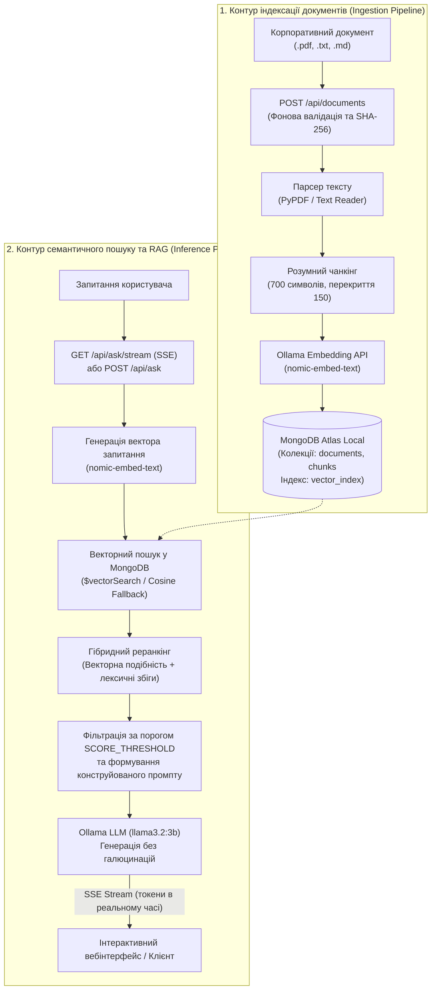

# Corporate Knowledge Base RAG Service (Локальна RAG-система)

[](https://fastapi.tiangolo.com)
[](https://www.python.org/)
[](https://www.mongodb.com/)
[](https://ollama.ai/)
[](https://www.docker.com/)

Повністю автономна, локальна **RAG-система (Retrieval-Augmented Generation)** для семантичного пошуку та інтелектуальної генерації відповідей за базою корпоративних документів. Працює на 100% локально без надсилання даних у зовнішні хмарні сервіси, гарантуючи конфіденційність даних.

Сервіс поєднує зберігання векторних представлень у **MongoDB Atlas Local 8.0**, локальні моделі **Ollama** (`llama3.2:3b` та `nomic-embed-text`), гібридний реранкінг, потокову генерацію відповідей за протоколом **SSE (Server-Sent Events)** та інтерактивний вебінтерфейс.

---

## 🛠 Технологічний стек

* **Бекенд-фреймворк:** FastAPI (Python 3.11+), Uvicorn
* **Векторна база даних:** MongoDB Atlas Local 8.0.0 (Replica Set із підтримкою `$vectorSearch` та fallback-механізмом косинусної подібності)
* **Нейромережевий рушій:** Ollama (локальний інференс із підтримкою GPU NVIDIA)
  * **LLM (генерація відповідей):** `llama3.2:3b` (контекст 4096 токенів)
  * **Embedding модель:** `nomic-embed-text` (високоточні 768-вимірні вектори)
* **Парсинг та обробка текстів:** PyPDF, регулярні вирази з урахуванням меж слів
* **Потокова передача:** SSE (`text/event-stream`)
* **Фронтенд:** Адаптивний вебінтерфейс (Vanilla JS, Modern CSS, доступний на `/`)
* **Контейнеризація:** Docker, Docker Compose з автоматичним завантаженням моделей (`ollama-init`)

---

## 🏛 Архітектура RAG-пайплайну

Система розділена на два основні контури: **контур індексації знань (Ingestion Flow)** та **контур семантичного пошуку й генерації (Query & Generation Flow)**:



---

## 💎 Ключові інженерні особливості

1. **Повна автономність та безпека:**
   * Усі компоненти (LLM, база даних, бекенд) розгортаються локально. Корпоративні дані не залишають контур вашої інфраструктури.
2. **Дворівневий векторний пошук із Fallback:**
   * Основним механізмом є нативний пайплайн агрегації MongoDB Atlas `$vectorSearch`.
   * Якщо векторний індекс ще ініціалізується або перебуває в процесі побудови, репозиторій автоматично перемикається на вбудований алгоритм розрахунку косинусної подібності (`cosine similarity calculation`), гарантуючи 100% аптайм відповідей.
3. **Гібридне ранжування (Hybrid Lexical-Vector Reranking):**
   * Результати семантичного векторного пошуку додатково скоригуються лексичним аналізом частоти ключових термінів запитання, підвищуючи точність пошуку специфічних назв, дат та артикулів.
4. **Захист від галюцинацій (Strict Grounding):**
   * Системний промпт суворо обмежує контекст виключно наданими фрагментами документів. Якщо інформації недостатньо, модель прямо повідомляє про це, вказуючи, які саме частини запитання не вдалося покрити джерелами.
5. **Автоматична оркестрація моделей у Docker Compose:**
   * Сервіс `ollama-init` автоматично завантажує необхідні ваги моделей `nomic-embed-text` та `llama3.2:3b` при першому старті, чекаючи на повну готовність перед запуском API.
6. **Потоковий інтерфейс (SSE):**
   * Ендпоінт `/api/ask/stream` транслює згенеровані токени «на льоту» з підтримкою скасування генерації клієнтом при закритті з'єднання.

---

## 📁 Структура проєкту

```text
docker-base/
├── app/
│   ├── ai/
│   │   ├── base.py                 # Інтерфейси LLMClient та EmbeddingClient
│   │   └── ollama.py               # Реалізація взаємодії з Ollama API
│   ├── api/
│   │   ├── dependencies.py         # Фабрики впровадження сервісів та налаштувань
│   │   └── routers/
│   │       ├── ask.py              # Ендпоінти /api/ask (звичайний та SSE-стримінг)
│   │       └── documents.py        # Ендпоінти завантаження, лістингу та видалення файлів
│   ├── core/
│   │   ├── config.py               # Pydantic Settings (параметри RAG, Ollama, Mongo)
│   │   └── database.py             # Ініціалізація підключення та індексів MongoDB
│   ├── models/
│   │   └── document.py             # Схеми документів та чанків для бази даних
│   ├── repositories/
│   │   ├── chunk_repo.py           # Збереження векторів, $vectorSearch, косинусний fallback
│   │   └── document_repo.py        # CRUD документів, контроль хешів та статусів
│   ├── schemas/
│   │   ├── document.py             # Pydantic DTO моделей документів
│   │   └── rag.py                  # DTO запитів/відповідей запитань (AskRequest, AskResponse)
│   ├── services/
│   │   ├── ingestion.py            # Парсинг (.pdf, .txt, .md), чанкінг та ембеддинг
│   │   ├── rag.py                  # RAG-оркестрація, побудова системних промптів
│   │   └── retrieval.py            # Пошук чанків, порогова фільтрація та реранкінг
│   ├── static/
│   │   ├── app.js                  # Логіка фронтенду (чат, SSE-парсер, завантаження)
│   │   ├── index.html              # Розмітка вебінтерфейсу
│   │   └── style.css               # Стилі сучасного інтерфейсу бази знань
│   └── main.py                     # Запуск FastAPI, монтування статики, healthcheck
├── tests/
│   └── test.py                     # Комплексні юніт- та інтеграційні тести RAG
├── docker-compose.yml              # Стек: API + MongoDB Atlas Local + Ollama + Ollama-Init
├── Dockerfile                      # Складання бекенд-контейнера
├── requirements.txt                # Залежності Python
└── README.md                       # Документація проєкту
```

---

## 🚀 Швидкий запуск

### 1. Клонування репозиторію
```bash
git clone https://github.com/kirkiiruch/local-rag-knowledge-base.git
cd local-rag-knowledge-base
```

### 2. Конфігурація змінних оточення
Створіть `.env` файл у кореневій директорії проєкту:
```bash
cp .env.example .env
```

Зразок конфігурації `.env`:
```env
APP_PORT=8000
MONGODB_URL=mongodb://mongodb:27017
MONGODB_DB_NAME=knowledge_base
OLLAMA_URL=http://ollama:11434
LLM_MODEL=llama3.2:3b
EMBEDDING_MODEL=nomic-embed-text
CHUNK_SIZE=700
CHUNK_OVERLAP=150
TOP_K=5
SCORE_THRESHOLD=0.8
MAX_FILE_SIZE_MB=10
```

### 3. Запуск стеку в Docker Compose
```bash
docker compose up -d --build
```
> [!NOTE]
> При першому старті контейнер `kb_ollama_init` автоматично завантажить моделі `nomic-embed-text` та `llama3.2:3b`. Слідкувати за прогресом можна за допомогою команди:
> ```bash
> docker compose logs -f ollama-init
> ```

Після завершення ініціалізації вебінтерфейс буде доступний за адресою: **`http://localhost:8000`**.

---

## 🖥 Вебінтерфейс

Відкрийте браузер за адресою `http://localhost:8000`:
* **Панель керування документами (зліва):** завантаження файлів (`.pdf`, `.txt`, `.md`), перегляд кількості згенерованих векторних чанків, статус індексації та кнопка видалення.
* **Інтерактивний чат (по центру):** введення запитань, потоковий вивід тексту в реальному часі (SSE), перегляд списку використаних першоджерел із номерами сторінок та відсотком семантичної відповідності.

---

## 📡 Специфікація REST API

### Робота з документами (`/api/documents`)

| Метод | Маршрут | Опис |
| :--- | :--- | :--- |
| **POST** | `/api/documents` | Завантаження нового документа (`multipart/form-data`) для фонової індексації |
| **GET** | `/api/documents` | Отримання списку всіх документів із поточними статусами обробки |
| **GET** | `/api/documents/{id}` | Детальна інформація про документ та всі його текстові фрагменти (чанки) |
| **DELETE**| `/api/documents/{id}` | Повне видалення документа та його векторних ембеддингів із бази даних |

### Семантичний пошук та генерація відповідей (`/api/ask`)

#### 1. Стандартний запит (POST `/api/ask`)
```bash
curl -X POST "http://localhost:8000/api/ask" \
  -H "Content-Type: application/json" \
  -d '{
    "question": "Які умови повернення товару згідно з регламентом?",
    "top_k": 5
  }'
```
*Відповідь (200 OK):*
```json
{
  "answer": "Згідно з регламентом (Документ: policy.pdf, стор. 4), повернення товару можливе протягом 14 днів...",
  "sources": [
    {
      "document_id": "671cb0a...",
      "filename": "policy.pdf",
      "page": 4,
      "score": 0.89
    }
  ]
}
```

#### 2. Потоковий запит SSE (GET `/api/ask/stream`)
```bash
curl -N "http://localhost:8000/api/ask/stream?question=Які%20умови%20повернення%20товару"
```
Повертає потік подій `data: {"token": "..."}\n\n` та фінальну подію `data: [DONE]`.

---

## 🧪 Запуск тестів (Pytest)

Репозиторій містить вичерпні юніт- та інтеграційні тести, що перевіряють роботу моделей, налаштувань, чанкінгу та репозиторіїв:
```bash
# Запуск усередині контейнера:
docker compose exec api pytest tests/test.py -v

# Або на хості (за наявності venv):
pytest tests/test.py -v
```

---

## 🛑 Керування контейнерами

* **Зупинка сервісів:**
  ```bash
  docker compose down
  ```
* **Повна зупинка з видаленням збережених баз даних та завантажених моделей:**
  ```bash
  docker compose down -v
  ```
